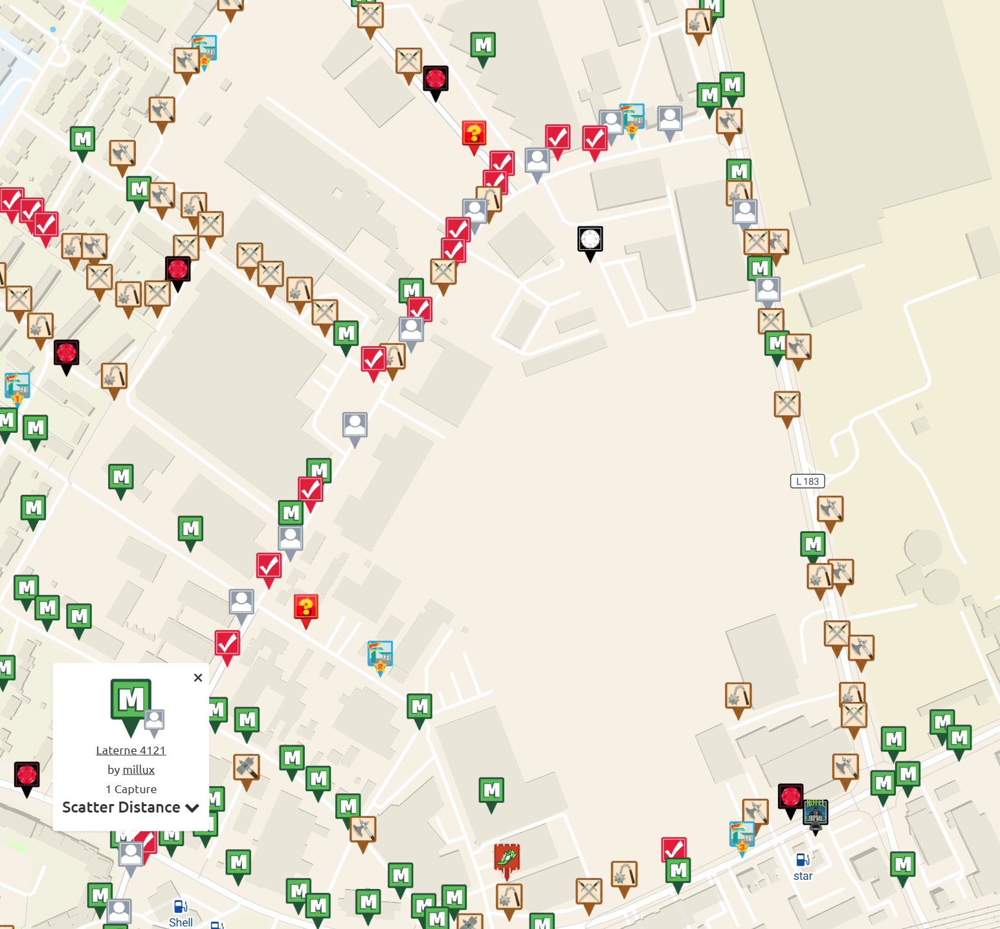
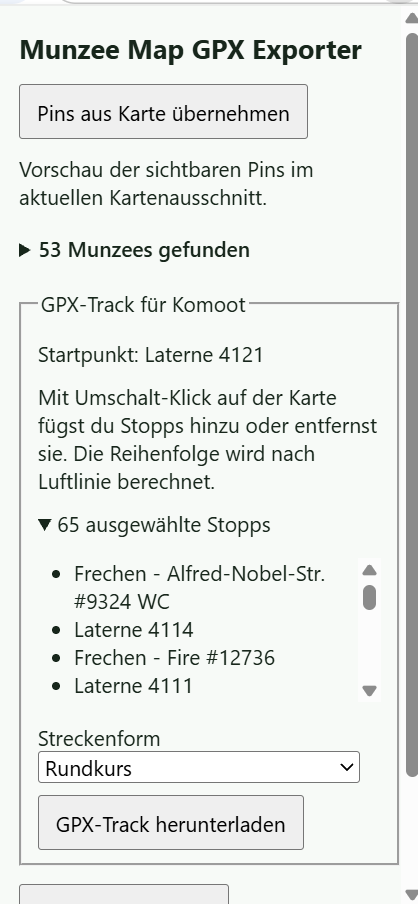
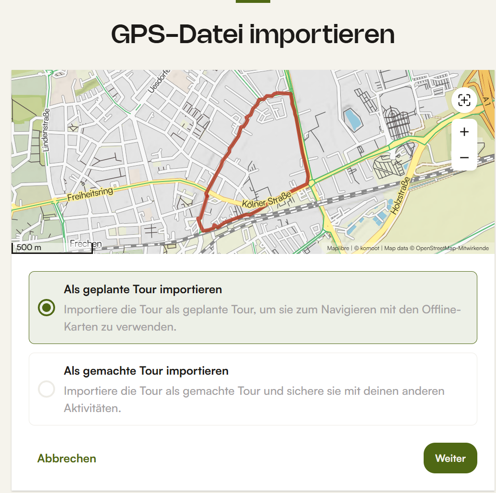
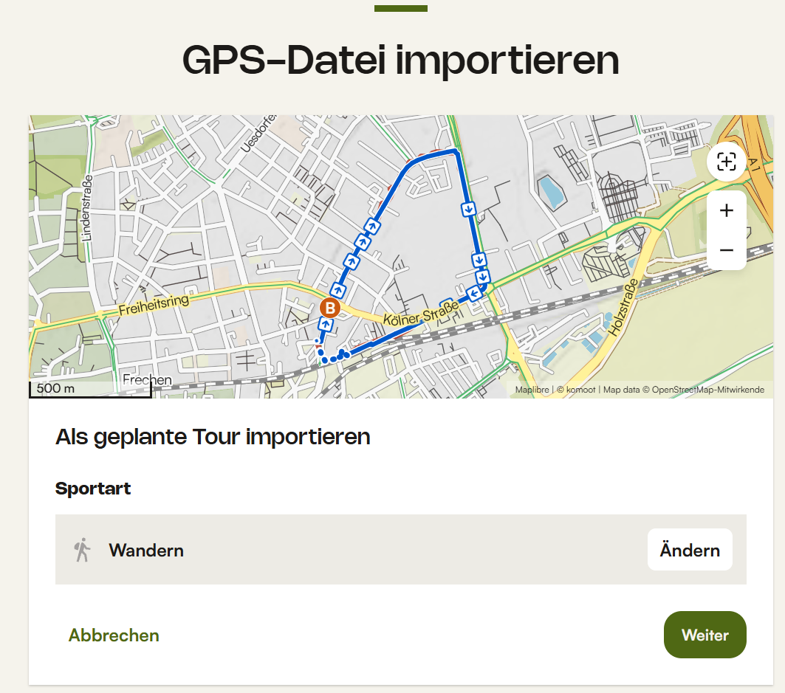
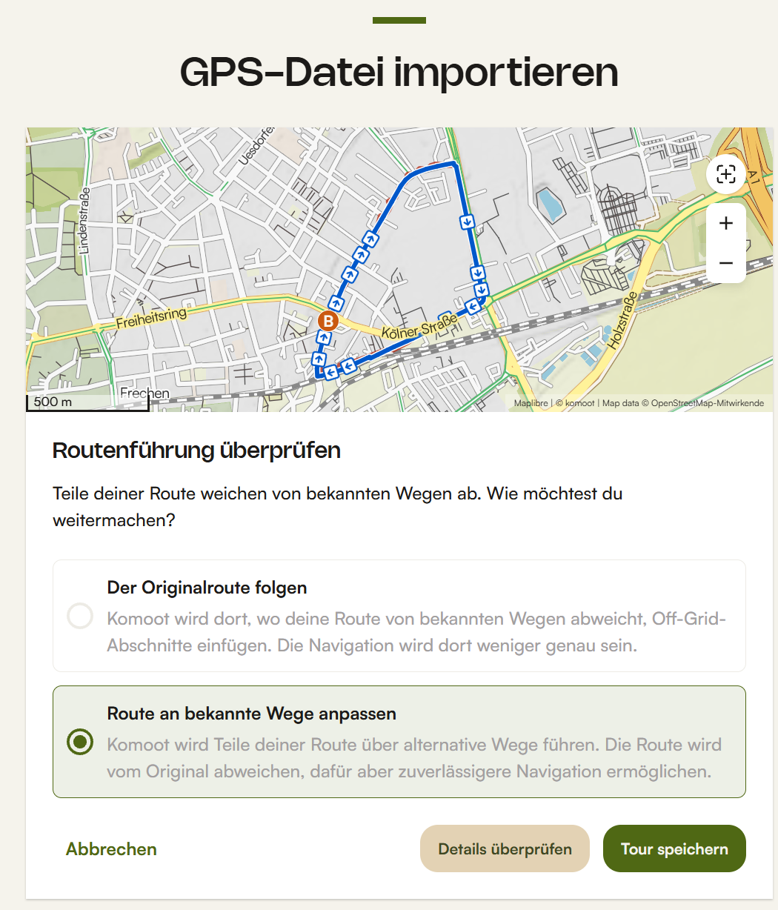
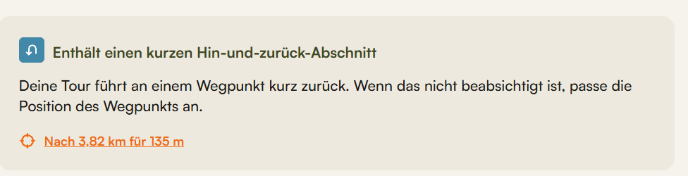
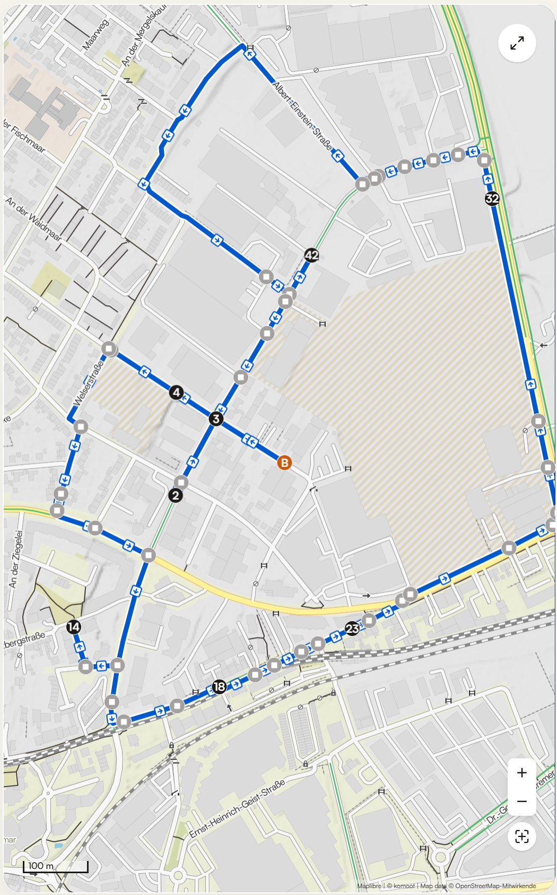

# Munzee Map GPX Exporter

Eine kleine Chrome-Erweiterung, die sichtbare Pins im aktuellen Ausschnitt der [Munzee-Karte](https://www.munzee.com/map/) als GPX-Wegpunkte oder CSV exportiert.

## Lokal in Chrome installieren

Die fertige Erweiterung findest du auf GitHub unter [Releases](https://github.com/marsrakete/MunzeeMapGPXExporter/releases). Lade dort `munzee-map-gpx-exporter.zip` herunter und entpacke sie. GitHub Actions stellt die ZIP auch bei erfolgreichen Builds unter **Artifacts** bereit. Der Dateiname bleibt bei jeder Version gleich.

1. Öffne `chrome://extensions/` in Chrome und aktiviere den **Entwicklermodus**.
2. Wähle **Entpackte Erweiterung laden** (*Load unpacked*).
3. Wähle den entpackten Ordner mit der `manifest.json`. Wenn du mit einer lokalen Kopie des Repositorys arbeitest, wähle den Projektordner **extension**. Die Erweiterung benötigt Chrome 111 oder neuer.
4. Öffne die Munzee-Karte und melde dich dort selbst an. Lade die Karte einmal neu, falls sie bereits geöffnet war oder du über die Seitennavigation auf die Karte gelangt bist.
5. Wähle einen Kartenausschnitt und warte, bis die Pins geladen sind. Öffne das Erweiterungssymbol und klicke auf **Pins aus Karte übernehmen**. Die Vorschau zeigt die Anzahl, Namen und Koordinaten.
6. Wähle **GPX herunterladen** oder **CSV herunterladen**. Wenn du den Ausschnitt änderst, öffne das Popup erneut oder klicke auf **Pins aus Karte übernehmen**. Die Vorschau wird durch den aktuellen Ausschnitt ersetzt.

Nach einem Update klicke bei der Erweiterung unter `chrome://extensions/` auf **Neu laden** und lade anschließend den Kartentab neu.

Wenn du das Symbol in der Chrome-Symbolleiste anheftest, erscheint es auf der Munzee-Karte farbig und auf anderen Seiten grau.

## Track für Komoot

Klicke den gewünschten Start-Munzee direkt auf der Munzee-Karte an. Halte **Umschalt** gedrückt und klicke weitere Pins an, um sie als Stopps aufzunehmen. Ein weiterer Umschalt-Klick auf denselben Pin entfernt ihn wieder. Die Karte bestätigt die Auswahl kurz nach jedem Klick.

Öffne die Erweiterung, um den Start und die ausgewählten Stopps zu prüfen. Der Track benötigt den Start und mindestens einen weiteren ausgewählten Stopp. Die Auswahl bleibt beim Verschieben oder Zoomen erhalten und umfasst auch Pins außerhalb des aktuellen Ausschnitts. Beim Neuladen der Karte wird die Auswahl zurückgesetzt.

Wähle **Rundkurs** für die Rückkehr zum Start oder **Ende am entferntesten Munzee** für eine offene Strecke. Die Entfernung zum Ziel wird ab dem gewählten Start nach Luftlinie gemessen.

**GPX-Track herunterladen** erzeugt `munzees-track.gpx` mit dem Start und allen ausgewählten Stopps als benannten Wegpunkten und einem Track in Besuchsreihenfolge. Die Erweiterung berechnet lokal eine kurze Reihenfolge nach Luftlinie. Sie garantiert keine kürzeste Gesamttour.

### In Komoot importieren

1. Öffne die GPX-Datei in Komoot und wähle **Als geplante Tour importieren**.

   

2. Wähle die passende Sportart, zum Beispiel **Wandern**.

   

3. Wähle bei Bedarf **Route an bekannte Wege anpassen**. Prüfe vor dem Speichern, ob die Tour weiterhin an den gewünschten Stopps vorbeiführt.

   

4. Prüfe im Routenplaner Hinweise auf kurze Hin- und Rückwege. Ein solcher Abschnitt kann beabsichtigt sein, wenn ein Stopp abseits des Hauptwegs liegt.

   

   

## Dateiformate

Die GPX-1.1-Datei enthält pro Pin einen `<wpt>` mit Namen und Munzee-URL in `<name>` und `<desc>`. CSV enthält die Spalten `name,url,latitude,longitude`. Die Datei ist UTF-8 und verwendet Kommas als Feldtrenner und Punkte als Dezimaltrenner.

## Welche Pins erfasst werden

- Der Export über **GPX herunterladen** und **CSV herunterladen** verwendet die Pins aus der letzten Vorschau des sichtbaren Kartenausschnitts. Die Erweiterung fragt die von Munzee gerenderte Pin-Ebene ab. So gelten auch die Filter der Karte. Der Track-Export verwendet den Start und alle manuell ausgewählten Stopps, auch außerhalb des aktuellen Ausschnitts.
- Duplikate durch überlappende Kartenkacheln werden anhand der Munzee-URL oder ID entfernt. Ladegrenzen und Zoomstufe beeinflussen, welche Pins Munzee zeichnet. Eine vollständige Liste aller Munzees im gewählten Gebiet ist nicht garantiert.
- Wenn die Vorschau leer bleibt, warte, bis die Karte fertig geladen ist. Prüfe die Anmeldung und Hinweise der Karte zur Zoomstufe. Eine Änderung der Kartenimplementierung kann eine Anpassung des Kartenadapters erfordern.

## Datenfluss und Dateien

Für eine neue Version passe die Versionsnummer in `extension/manifest.json` an und pushe einen passenden Tag wie `v0.7.1`. Nach erfolgreichen Tests veröffentlicht GitHub Actions das Release mit der installierbaren ZIP.

Die Karte lädt Teilbereiche und übergibt die gefilterten Pins als GeoJSON an ihre MapLibre-Ebene `icons`. Der Adapter findet die bestehende Karteninstanz über die React-Referenz am Kartencontainer und liest die gerenderten Features per `queryRenderedFeatures`. Name, URL und Koordinaten stammen aus den Eigenschaften dieser Pins.

| Datei | Aufgabe |
| --- | --- |
| `extension/manifest.json` | Manifest V3 und Beschränkung der Skripte auf die Munzee-Karte |
| `extension/map-view.js` | Liest die gerenderten Pins im aktuellen Kartenausschnitt und übergibt nur geprüfte Pin-Felder und Statussignale |
| `extension/collector.js` | Fragt die aktuelle Ansicht für das Popup ab und entfernt Duplikate |
| `extension/popup.html`, `popup.css`, `popup.mjs` | Vorschau, Fehlermeldungen und Download-Schaltflächen |
| `extension/export.mjs` | Erstellt GPX und CSV für den lokalen Download |
| `extension/tour.mjs` | Berechnet die Besuchsreihenfolge nach Luftlinie mit festem Start und Ziel |

Die Erweiterung stellt selbst keine Netzwerkanfragen und greift nicht auf die Netzwerkantworten oder Anmeldedaten zu. Chrome erzeugt die Dateien lokal aus der Vorschau. Die Berechtigung `declarativeContent` schaltet das Symbol anhand der URL frei. Die Erweiterung braucht keinen direkten Zugriff auf den API-Host.
